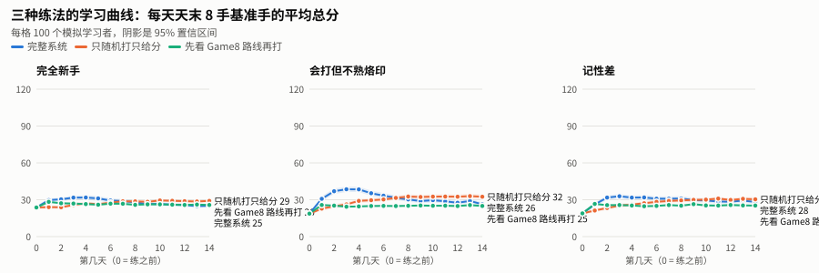

# 模拟学习者实验结果（脚本生成）

由 `node scripts/simulate.js` 生成，别手改。说明和成功标准见 [../simulation-report.md](../simulation-report.md)。

- 学习模型：v2：可迁移的知识单位（docs/simulation-report.md「第二版学习模型」）
- 运行：`node scripts/simulate.js --only main`
- 用时：53.7 分钟（11 个工人进程，900 个学习者任务）
- 每格学习者：100；练习池 2000 手（其中搜索超时 2 手）；基准手 8 手搜索：搜完、搜完、搜完、搜完、搜完、搜完、搜完、搜完

数字是第 14 天天末考试的基准手平均总分（8 手的平均，再对学习者平均），括号是 95% 置信区间；差是同一个学习者种子配对的差。

## 结论

- 成功标准（完整系统 − 只随机打 ≥ 15，三种画像都成立）：主实验 **不成立**；敏感性 没跑；合起来 **没过**
- 去功能（有可测贡献 = 至少一个画像里完整系统高 ≥ 2 分且配对差 95% 区间不含 0）：这次没跑

## 主实验

| 画像 | 完整系统 | 只随机打只给分 | 先看 Game8 路线 | 完整 − 只随机打 | 完整 − Game8 |
|---|---|---|---|---|---|
| 完全新手 | 25.1（23.7–26.5） | 29.1（28.0–30.1） | 25.7（24.9–26.6） | -3.9（-5.7–-2.2） | -0.6（-2.2–1.0） |
| 会打但不熟烙印 | 26.3（24.8–27.9） | 32.5（30.6–34.3） | 24.9（24.0–25.9） | -6.2（-8.5–-3.8） | 1.4（-0.5–3.2） |
| 记性差 | 28.2（26.5–29.9） | 30.4（28.6–32.1） | 25.3（24.2–26.3） | -2.1（-4.4–0.1） | 3.0（1.1–4.8） |

第 0 天（练之前）：完全新手 23.7 / 23.7 / 23.7；会打但不熟烙印 18.7 / 18.7 / 18.7；记性差 18.9 / 18.9 / 18.9

每天的数：

| 画像 | 练法 | 第0天 | 第1天 | 第2天 | 第3天 | 第4天 | 第5天 | 第6天 | 第7天 | 第8天 | 第9天 | 第10天 | 第11天 | 第12天 | 第13天 | 第14天 |
|---|---|---|---|---|---|---|---|---|---|---|---|---|---|---|---|---|
| 完全新手 | 完整系统 | 23.7 | 29.7 | 30.4 | 31.7 | 31.8 | 31.1 | 29.4 | 28.9 | 27.9 | 26.5 | 26.6 | 26.0 | 25.7 | 24.8 | 25.1 |
| 完全新手 | 只随机打只给分 | 23.7 | 24.0 | 23.9 | 25.8 | 27.1 | 26.4 | 27.7 | 28.7 | 28.7 | 28.3 | 29.4 | 29.1 | 28.8 | 28.6 | 29.1 |
| 完全新手 | 先看 Game8 路线再打 | 23.7 | 28.3 | 27.1 | 26.9 | 26.5 | 26.0 | 26.8 | 26.7 | 25.8 | 26.3 | 26.3 | 26.0 | 25.8 | 26.1 | 25.7 |
| 会打但不熟烙印 | 完整系统 | 18.7 | 30.8 | 36.9 | 38.5 | 38.4 | 35.3 | 33.3 | 31.7 | 30.3 | 28.9 | 29.6 | 28.7 | 27.5 | 29.0 | 26.3 |
| 会打但不熟烙印 | 只随机打只给分 | 18.7 | 22.8 | 24.7 | 26.2 | 29.1 | 29.6 | 30.2 | 31.5 | 32.6 | 32.2 | 32.5 | 32.6 | 32.5 | 33.0 | 32.5 |
| 会打但不熟烙印 | 先看 Game8 路线再打 | 18.7 | 25.7 | 25.2 | 24.3 | 24.6 | 24.9 | 25.0 | 24.9 | 25.1 | 25.3 | 25.1 | 25.2 | 24.9 | 25.7 | 24.9 |
| 记性差 | 完整系统 | 18.9 | 26.1 | 31.8 | 32.8 | 31.8 | 31.9 | 30.9 | 30.8 | 31.0 | 29.7 | 29.4 | 28.5 | 28.4 | 29.3 | 28.2 |
| 记性差 | 只随机打只给分 | 18.9 | 21.2 | 23.3 | 25.2 | 26.1 | 27.2 | 28.3 | 29.0 | 29.4 | 29.9 | 30.1 | 31.0 | 29.8 | 30.7 | 30.4 |
| 记性差 | 先看 Game8 路线再打 | 18.9 | 26.6 | 25.6 | 25.7 | 25.3 | 24.7 | 25.0 | 25.7 | 25.2 | 26.4 | 25.4 | 25.3 | 25.7 | 25.4 | 25.3 |

## 14 天里做了什么（每个学习者平均）

| 画像 | 练法 | 练习手 | 其中基准手 | 没法结算而作废的手 | 考试里没法结算的比例 | 提示 | 看复盘学到的步 | 记卡答题 | 看路线的步 | 记住的决定点 |
|---|---|---|---|---|---|---|---|---|---|---|
| 完全新手 | 完整系统 | 122.6 | 0.0 | 0.8 | 0.3% | 33.5 | 117.0 | 148.1 | 0.0 | 72.1 |
| 完全新手 | 只随机打只给分 | 235.4 | 0.0 | 0.3 | 0.1% | 0.0 | 0.0 | 0.0 | 0.0 | 7.5 |
| 完全新手 | 先看 Game8 路线再打 | 128.4 | 0.0 | 0.9 | 0.5% | 0.0 | 0.0 | 0.0 | 280.0 | 38.0 |
| 会打但不熟烙印 | 完整系统 | 158.8 | 0.0 | 2.0 | 0.2% | 44.0 | 148.9 | 134.1 | 0.0 | 83.2 |
| 会打但不熟烙印 | 只随机打只给分 | 359.8 | 0.0 | 0.9 | 0.1% | 0.0 | 0.0 | 0.0 | 0.0 | 21.2 |
| 会打但不熟烙印 | 先看 Game8 路线再打 | 194.6 | 0.0 | 2.0 | 0.5% | 0.0 | 0.0 | 0.0 | 280.0 | 40.4 |
| 记性差 | 完整系统 | 130.8 | 0.0 | 1.5 | 0.3% | 36.2 | 123.7 | 171.3 | 0.0 | 76.1 |
| 记性差 | 只随机打只给分 | 265.0 | 0.0 | 0.8 | 0.1% | 0.0 | 0.0 | 0.0 | 0.0 | 15.0 |
| 记性差 | 先看 Game8 路线再打 | 152.1 | 0.0 | 1.5 | 0.7% | 0.0 | 0.0 | 0.0 | 280.0 | 39.4 |
