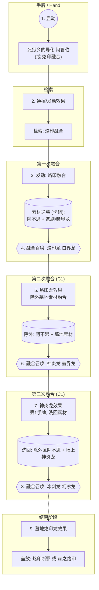
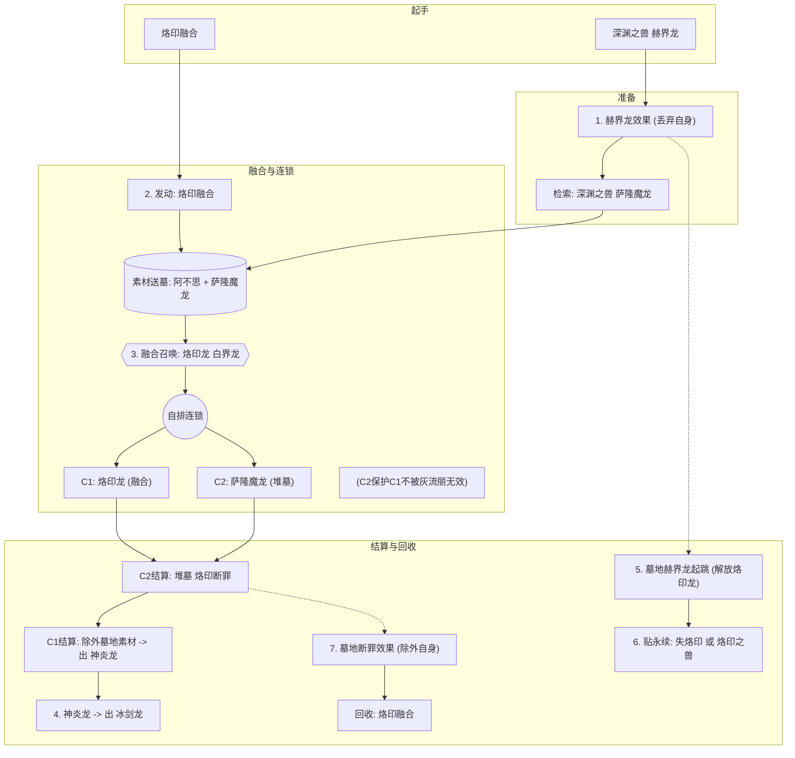
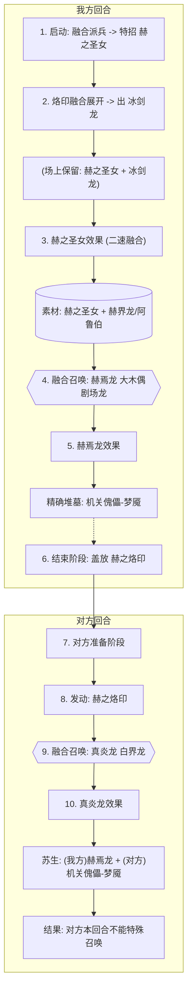

## 模式一：基础单卡展开

**手牌要求：** 《烙印融合》或 《死狱乡的导化 阿鲁伯》

**目标：** 确立《冰剑龙 幻冰龙》压制，并调度回合结束阶段的续航。

### 展开流程图

### 最终盘面
- **怪兽区**：《冰剑龙 幻冰龙》
- **魔陷区**：《烙印断罪》或《赫之烙印》（盖放）
- **妨害数**：1-2（冰剑龙二速除外 + 盖放的陷阱）

---

## 模式二：进阶双卡资源回收

**手牌要求：** 《烙印融合》+ 《深渊之兽 赫界龙》

**核心技巧：** 利用连锁保护（Chain Block）防止《灰流丽》，并通过《萨隆魔龙》堆墓《烙印断罪》回收《烙印融合》。

### 展开流程图

### 最终盘面
- **怪兽区**：《冰剑龙 幻冰龙》+《深渊之兽 赫界龙》
- **魔陷区**：《失烙印》或《烙印之兽》
- **手牌**：回收的《烙印融合》
- **妨害数**：2-3（冰剑龙 + 永续陷阱 + 后续资源）

---

## 模式三：机关傀儡封锁（高级）

**手牌要求：** 《融合派兵》（或能调度赫圣女的卡）+ 烙印动点

**目标：** 在对方回合将《机关傀儡-梦魇》特招到对方场上，封锁对方特招。

### 展开流程图

### 最终盘面（对方回合）
- **我方怪兽区**：《冰剑龙》+《真炎龙 白界龙》+《赫焉龙》
- **对方怪兽区**：《机关傀儡-梦魇》（封锁特招）
- **妨害数**：完全封锁（对方无法特殊召唤）

---

## 战术注意事项

### 自排连锁 (Chain Blocking)
在融合召唤成功时，如果送墓的素材（如《悲剧》、《萨隆》）和融合怪兽（如《烙印龙》）的效果同时满足条件，你可以自选连锁顺序。

**技巧：** 将关键效果（如《烙印龙》的融合）放在 C1，次要效果（如堆墓/检索）放在 C2。这样对手的《灰流丽》只能连锁 C2，从而保护 C1 必定通过。

### 必须注意的自肃
- **《烙印融合》：** 发动此卡的回合，你只能从额外卡组特殊召唤融合怪兽。
- **《烙印开幕》：** 发动后，直到回合结束只能从额外卡组特殊召唤融合怪兽。
- **《融合派兵》：** 发动后，直到回合结束只能从额外卡组特殊召唤融合怪兽。
